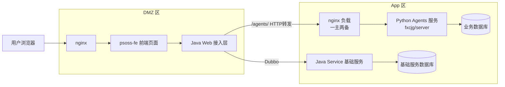
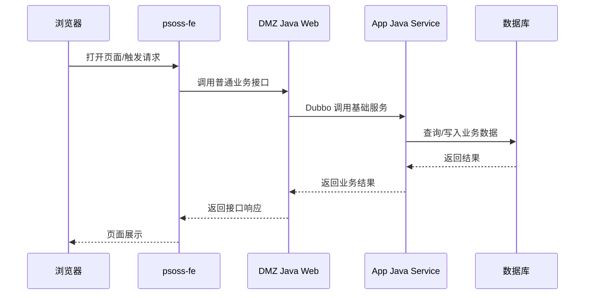
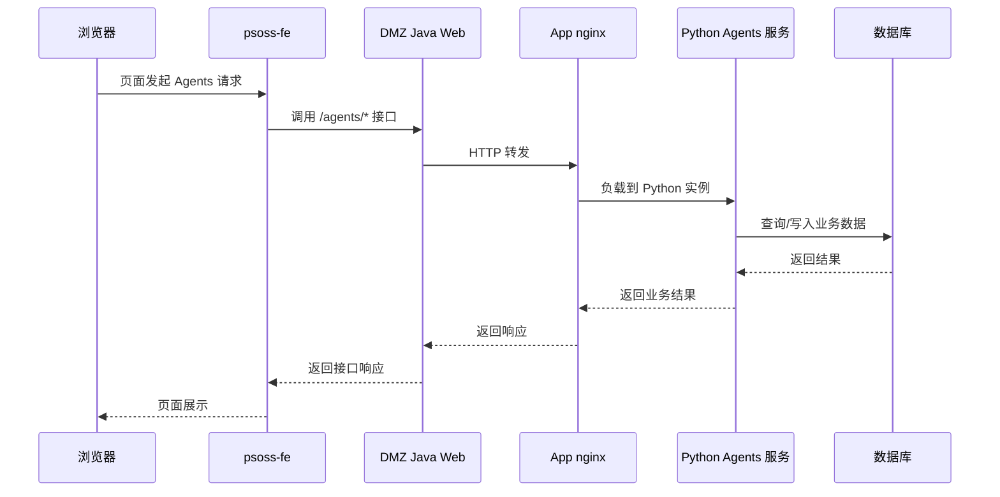

# 项目总体开发情况说明

## 一页总览

当前项目整体采用“前端页面 + DMZ 接入层 + App 业务层 + 基础服务层”的分层架构。

- 前端项目为 `psoss-fe`，本地开发通过 `npm run dev` 启动，UAT 和生产部署在 DMZ 区的 `nginx` 上。
- DMZ 区存在一个 Java Web 项目，负责对前端提供统一 API，其中 `/agents/` 开头的接口会继续转发到 App 区的 Python 项目。
- App 区存在一个 Python 项目，即当前仓库的 `server`，负责 Agents 相关业务能力，前置 `nginx` 负载，一主两备，并直接连接数据库。
- App 区还存在一个 Java Service 项目，负责用户、权限及大部分基础业务能力，由 DMZ 区 Java Web 项目通过 `Dubbo` 协议访问，并直接连接数据库。

## 项目职责表

| 项目 | 所在区域 | 技术栈 | 主要职责 | 访问方式 |
|---|---|---|---|---|
| `psoss-fe` | DMZ | 前端 | 页面展示、前端交互 | 浏览器访问 |
| DMZ Java Web | DMZ | Java Web | 统一 API 接入层、请求转发 | 前端通过 HTTP/HTTPS 调用 |
| `fxcjg/server` | App | Python | Agents 相关业务能力 | DMZ Java Web 转发访问 |
| Java Service | App | Java Service | 用户、权限、基础业务能力 | DMZ Java Web 通过 Dubbo 调用 |

## 系统架构图

## 典型调用链路图

### 1. 普通业务接口

### 2. Agents 相关接口

## 环境与开发方式

### 本地开发

- 前端在本地通过 `npm run dev` 启动。
- Python 项目可在开发电脑本地直接启动进行联调验证。
- Agents 相关能力开发时，可以本地验证，也可以直连 UAT 环境验证。

### UAT / 生产部署

- 前端部署在 DMZ 区 `nginx`。
- DMZ Java Web 负责统一对外 API 接入。
- Python Agents 服务部署在 App 区，通过前置 `nginx` 做一主两备负载。
- Java Service 部署在 App 区，提供基础信息与通用业务能力。

## 当前开发状态总结

- 前端、DMZ 接入层、App Python 服务、App Java Service 的分工已经明确。
- `/agents/` 请求链路已经独立出来，便于后续持续扩展 Agent 能力。
- Python 项目作为 Agents 业务主载体，支持本地开发验证与 UAT 验证两种方式。
- Java Service 继续承载基础信息和通用业务能力，整体复用现有系统沉淀，减少重复建设。
